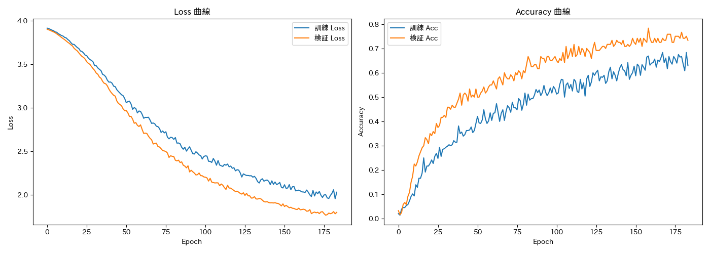
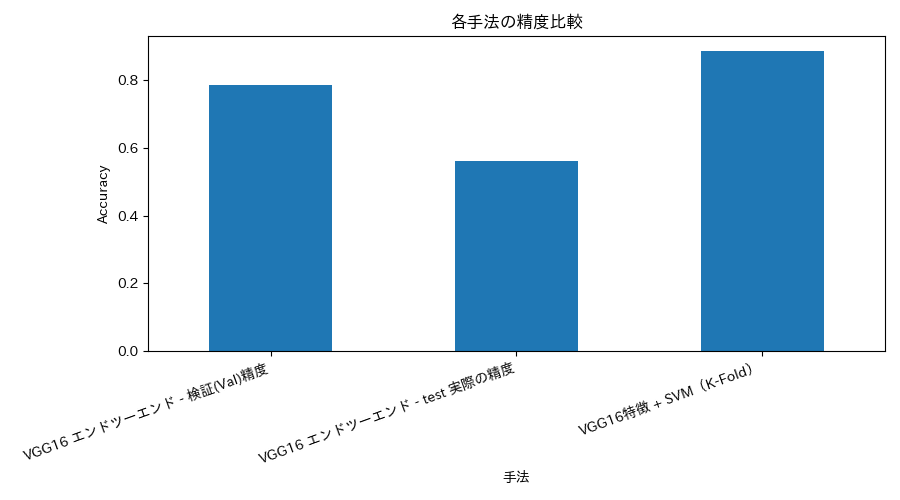

# 少数サンプルでのテクスチャ画像50クラス分類（VGG16 転移学習）

大学院の授業の期末課題。**各クラス12枚**という極めて少ない学習データで、
50クラスのテクスチャ／工業素材画像を分類しました。

## 手法
1. **VGG16 転移学習（エンドツーエンド）**
   - ImageNet 事前学習済み重みを使用し、畳み込み層は凍結して分類ヘッドのみ学習
   - Random Resized Crop などのデータ拡張で、同素材の局所パッチを擬似的に増やす
2. **VGG16 特徴抽出 + SVM（ハイブリッド手法）**
   - VGG16 を特徴抽出器としてのみ使い、RBF カーネル SVM で分類

## 結果
| 手法 | 評価方法 | 精度 |
|---|---|---|
| VGG16 エンドツーエンド | 検証データ | 78.3% |
| VGG16 エンドツーエンド | test データ | 56.0% |
| VGG16 特徴 + SVM | 4-Fold 交差検証 | 88.3% ± 1.4% |

## 考察
- 畳み込み層（block4, block5）を解凍すると検証精度は約99%まで上がるが、test 精度はむしろ低下した。
  サンプル数が極端に少ない場合、学習するパラメータを増やすと過学習しやすいことを確認した。
- 分類器を SVM に置き換えると精度が大きく改善したため、性能の差は特徴量の質ではなく、
  分類ヘッドの過学習によるものと考えられる。

## 使用技術
Python / PyTorch / torchvision / scikit-learn / Google Colab

## ファイル構成
| ファイル | 内容 |
|---|---|
| `1316260137.ipynb` | 実験ノートブック（EDA → 学習 → 評価 → 対照実験） |
| `dataset/` | train / test（50クラス） |
| `*.png` | 学習曲線、混同行列、手法比較、サンプル画像 |
| `test_predictions.csv` | test データの予測結果 |
